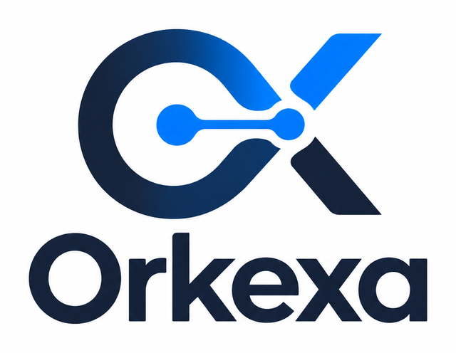

<div class="orkexa-hero" markdown>

</div>

# Orkexa

Orkexa is a Python library for tool-using AI agents and multi-agent systems with
**one** runtime for Anthropic Claude, OpenAI (Responses API), Google Gemini and
OpenAI-compatible endpoints (Ollama, vLLM, gateways). Providers are adapters; tools,
history, structured output, streaming, memory, RAG, evaluation, dynamic agents and
cost tracking are shared. Where a provider cannot do what you asked for, Orkexa raises
an error instead of silently doing something else.

!!! note "Status"
    Alpha (0.1.0, unreleased). The API may still change, and the package is not yet
    published on PyPI; see [Installation](getting-started/installation.md).

```python
from orkexa import Agent, Tool


@Tool
def add(a: int, b: int) -> int:
    """Add two integers.

    Args:
        a: First summand.
        b: Second summand.

    Returns:
        The sum.
    """
    return a + b


for model in ("anthropic:claude-sonnet-5-5", "openai:gpt-6.1-sol", "gemini:gemini-3.8-flash"):
    print(Agent(model=model, tools=[add]).ask("What is 17 + 25?"))
```

## Where to go next

| If you want to | Read |
| --- | --- |
| Install Orkexa and set up API keys | [Installation](getting-started/installation.md) |
| Build your first agent | [Quickstart](getting-started/quickstart.md) |
| Know what works on which provider | [Providers and capabilities](getting-started/providers.md) |
| Add tools, structured output, streaming, memory or RAG | [Guides](guides/tools-and-structured-output.md) |
| Run agents in production | [Security](guides/security.md) · [Data protection and AI regulation](compliance/index.md) · [Troubleshooting](troubleshooting.md) |
| Compare providers feature by feature | [Feature matrix](feature-matrix.md) |
| Understand the design | [Architecture and ADRs](architecture/target-architecture.md) |
| Contribute or release | [Development](development/index.md) |

Orkexa is an independent project, not affiliated with Anthropic, OpenAI or Google.
